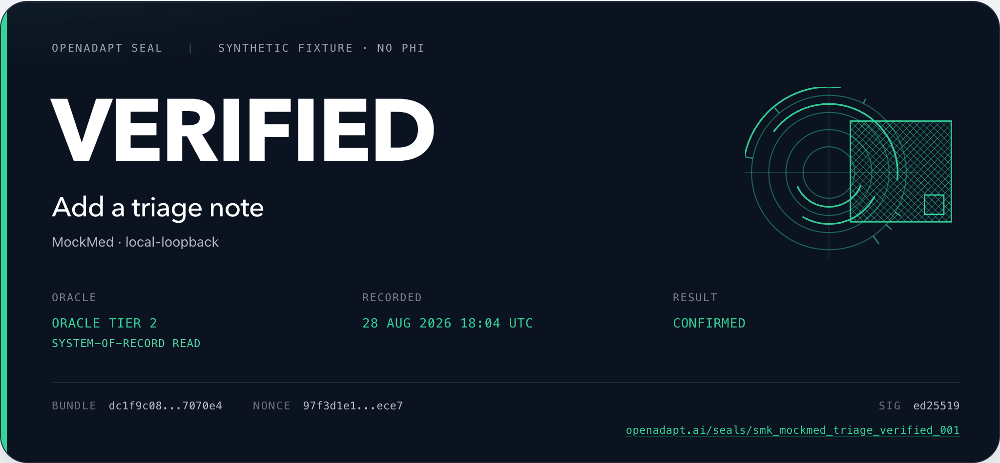
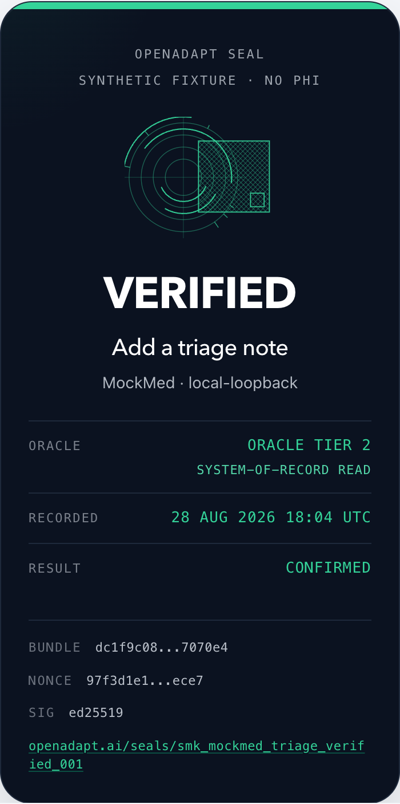

# The Seal

A Seal is a signed attestation that this program version, this identity, this
environment, and this independent effect produced a terminal outcome. The
portable object is `ExecuteEvidenceReceiptV1`. Execute issues it. Execute is
the invoke path, not a separate product.



*A VERIFIED Seal, desktop.*



*The same instrument, mobile.*

`POST /api/v1/executions` is the partner invoke. The terminal receipt is the
Seal. Local unsigned `openadapt-flow replay` stays free. Unsigned success is
failure: if a consequential tool returns done without a Seal, treat the call as
failed.

The compiler stays MIT. Record, compile, replay, halt, teach, `openadapt-types`,
local MCP, and Agent Skills stay inspectable.

Public verify pages list synthetic and non-PHI Seals. They do not list
healthcare production. Bundles are bound to one app build, one farm, one
resolution, one custom screen.

## Oracle tiers

Only a tier 2 or tier 3 oracle mints a production Seal.

| Tier | What it reads | Production Seal |
|---|---|---|
| 0 | Visual / OCR of the same screen that acted | Never. Dev only. |
| 1 | Second session or independent UI read | Never. |
| 2 | System-of-record read (API, database, file, ack) | Yes. |
| 3 | Counterparty artifact (payer status, legal export) | Yes. |

`oracle_tier` on the receipt must match `contracts.observed_effect_strength`.
`independent_system_of_record` maps to 2. `independent_session` maps to 1.
Screen confirmation and persisted-state reacquisition map to 0. Tier 3 has no
`EffectStrengthV1` member yet; it is a stronger independent artifact, not a
banner on the acting screen.

`openadapt flow tutorial --break-it` (or `openadapt quickstart --break-it`) is
the fail-closed demo. A fake success banner must halt, and the store must stay
unchanged. During qualification, `qualify propose` and `qualify accept` run the
proposed oracle against the same kind of fault on their own. An oracle that
doesn't catch it can't be accepted.

A Seal that points at a screenshot hash is a liability. Do not mint production
`verified` below tier 2.

## Attended and unattended operation

Attended is the mode available now. A person is already signed in to the
target application and the runner acts inside that session. When the runner
can't prove a required condition, the run pauses at `decision_required`. The
operator answers from the local console or the authenticated phone surface.
The runner then reacquires focus, a fresh observation, identity, and the
target before it continues.

In early access, a person reviews every entry before it is saved. That's how
we run early-access work today; the runtime doesn't enforce it yet.

That person stays the legal actor. A Seal is not a physician signature.

Unattended operation needs a dedicated agent identity, privileged access
management, and session recording, and it is qualified separately. In either
mode, OpenAdapt does not type a person's password, reuse a person's login, or
share a service account.

## CLI story

The public CLI doesn't issue a Seal yet. Execute issues it as the terminal
receipt of `POST /api/v1/executions`, which is open to approved pilot partners
only. `openadapt-flow replay` in Flow 1.35.1 has no option that issues a Seal.

A replay option that issues a Seal is planned, for a qualified synthetic bundle
with a tier-2 oracle. This page will name the Flow release that ships it. A
sealed verified run is designed to print `VERIFIED`, a seal id, and the public
verify URL:

```text
VERIFIED
seal_id  receipt_12345678
verify   https://openadapt.ai/seals/receipt_12345678
```

`openadapt flow seal SOURCE --out DESTINATION` is a different command. It
copies a bundle to a new directory and encrypts its workflow and template
evidence with `OPENADAPT_BUNDLE_KEY` for deployment. It doesn't run the
workflow or issue a Seal.

The verify route is `https://openadapt.ai/seals/{id}`. Synthetic fixtures only
on that page.

## Receipt fields are Seal fields

`ExecuteEvidenceReceiptV1` is the Seal. Map the receipt 1:1.

| Receipt field | Seal field | What it binds |
|---|---|---|
| `receipt_id` | Seal id | Public verify at `https://openadapt.ai/seals/{receipt_id}` |
| `execution_id` | execution | The `POST /v1/executions` that produced this Seal |
| `workflow_digest` | program digest | SHA-256 of the admitted compiled program |
| `workflow_version` | program version | Qualified version id |
| `qualification_id` | admission | The qualification pack that authorized the run |
| `environment_id` | environment | The qualified environment |
| `runner_id` | runner | The customer-controlled runner |
| `nonce` | nonce | Per-Seal uniqueness so a consumer does not need the original request |
| `oracle_tier` | oracle | 0 visual, 1 second-session, 2 system of record, 3 counterparty |
| `outcome` | outcome | `verified`, `halted_before_effect`, `reconciliation_required`, `rejected_policy`, `failed_platform`, or `rolled_back_verified` |
| `contracts` | contracts | Authorization, identity, postcondition, effect, required and observed strength, `model_used`, `external_network_used` |
| `delivery_uncertain` | delivery | True when a write may have landed |
| `compensation_effect_verified` | compensation | True only for `rolled_back_verified` |
| `evidence_digest` | evidence | Pointer to retained evidence. Bytes stay in the declared boundary. |
| `issued_at` | issued | When the Seal was issued |
| `schema_version` | schema | Always `openadapt.execute-evidence-receipt/v1` |

`verified` requires every contract, an observed strength at or above the
minimum, and `oracle_tier` 2 or 3. Store the full object with the partner
transaction. HTTP `202` is not a Seal.

## `requires_seal`

Consequential MCP tools advertise `requires_seal: true`. Skill text: if the
tool returns unsigned success, treat it as failure.

```json
{
  "name": "replay_program",
  "requires_seal": true
}
```

Emit a local MCP server with `openadapt flow emit-mcp bundle --out server.py`.
The partner still validates the Seal the same way: `receipt_id`,
`workflow_digest`, `oracle_tier`, and `outcome`.

## How it ships

A partner embeds OpenAdapt through Execute and MCP.

If Copilot, Power Automate, or another actuator already clicked, OpenAdapt can
still emit the Seal for that action when asked.

A compiled program is a cache when the job is stable. If a computer-use agent gets
cheap, the run still has to prove identity and effect, or halt.

Partner API contract: [Integrate OpenAdapt Execute](execute-api.md).
OEM embedding: [OpenAdapt Execute private-pilot guide](oem-brief.md).
Train against it: [Seal as an RL reward](seal-reward.md).
