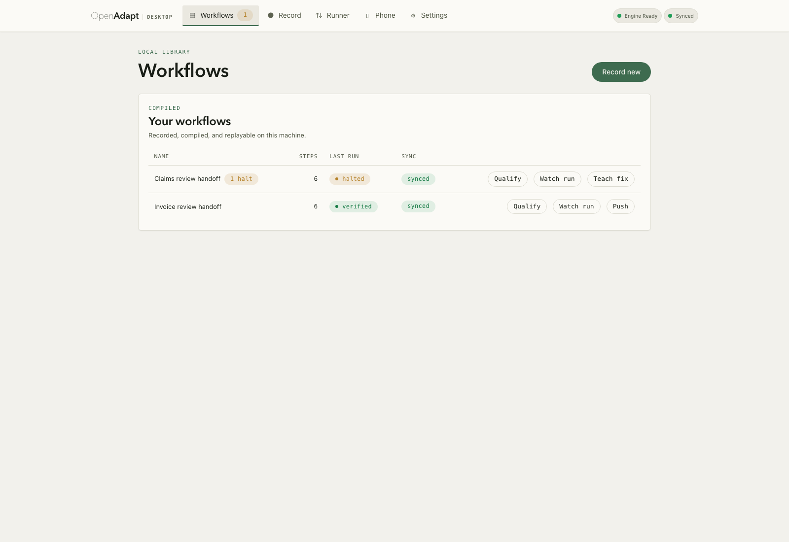
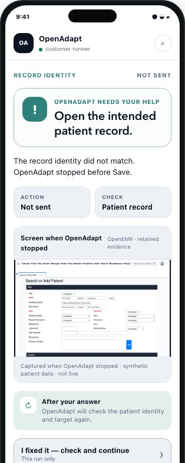
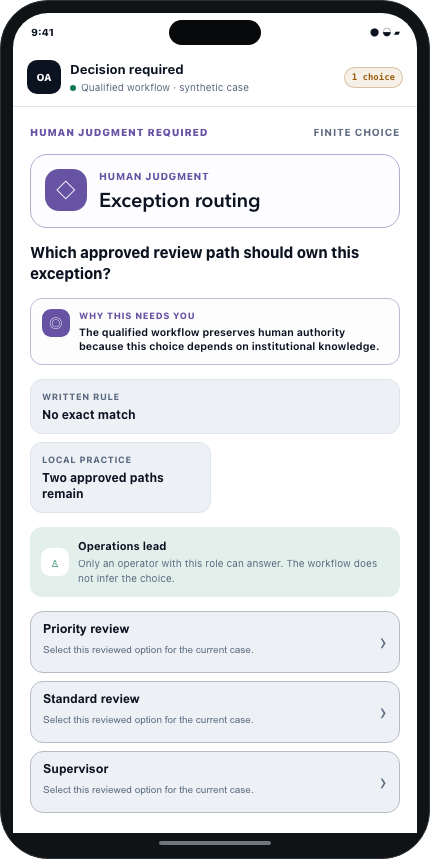

# What you see and control

Every run ends one of four ways, and each one tells your team what to do next.

| What you see | What it means | What your team does |
|---|---|---|
| Done and checked | It saved the entry and read the record back to confirm it. | Nothing. The receipt is the record of the work. |
| Stopped for review | Something didn't match, so it stopped before saving and asked a person. | Answer the question, or fix the input and run it again. |
| Check if it saved | It can't tell whether the save went through. | Look the record up before anyone retries. OpenAdapt won't retry on its own. |
| Didn't finish | It couldn't complete the task and saved nothing it couldn't confirm. | Check the computer or the connection, then run it again. |

"Done and checked" needs the record check. If a workflow has no second way to
read the saved record, a finished run is reported as finished but not checked,
and it never counts as "done and checked".

<figure markdown="span">
  { width="900" }
  <figcaption>Synthetic recording. The Desktop app lists each workflow with how its last run ended. One stopped for review and one was done and checked.</figcaption>
</figure>

## The receipt

Each run leaves a record of what it entered and how it checked the result.
The full report stays on the computer that ran the workflow, with your other
records.

The shareable receipt is built from a fixed list of fields, such as the
outcome, counts, and fingerprints of the evidence. It has no place for
screenshots, typed values, or patient names, so it can't carry them.

When a signature matters, for example to an auditor or to a partner's system,
a run can carry a signed receipt that can be checked later at a verify link.
Signed receipts come with Hosted or an Enterprise deployment, and only when
the record check read the system itself, not just the screen. A local run on
your own computer produces an unsigned report.

## When it stops

OpenAdapt stops instead of guessing when:

- The record on screen isn't the one it was asked to update, or it can't read
  the patient or account details clearly.
- The screen changed, and it can't find the same field with confidence.
- The saved record doesn't match what it entered, or the check can't reach the
  record.
- A step needs a decision that only a person should make.
- The screen shows something the recorded task didn't cover.

It's set to stop when unsure, so some stops turn out to be fine. In our fault
test on a test system, every check also stopped 9 of the 18 runs that had
saved correctly, because the reply from the server never arrived
([method and results](https://github.com/OpenAdaptAI/openadapt-flow/blob/aee094193b232f472f991be6fa9b33c3c4b3f9be/benchmark/effect_e2e/EFFECT_E2E.md)).
Each of those stops said the save might have gone through, so a person looks
the record up before anything is retried.

## What you approve

- Before it goes live, your team runs a readiness test with your own cases,
  including cases that should make it stop. A named person on your team
  approves the automation before it handles real work.
- When a screen changes, OpenAdapt first tries to find the same field again
  from what it recorded. If it can't, it stops. A fix can be proposed, and it
  goes through the same test and a person's approval before the automation
  uses it.
- A policy that your team reviews says which steps need the right-record check,
  which saves must be read back, and what the automation may never do.

## When a person steps in

When a run stops, the person responsible gets one question on a computer, or
on a phone if you set that up. They see the screen as it was when OpenAdapt stopped, and they pick an
answer. OpenAdapt then checks the screen and the record again before it
continues. A person's answer doesn't count as "done and checked" on its own.
The record check still has to pass.

The screen image and the values stay on the computer that ran the workflow. If
you use our hosted dashboard to watch for stops, it shows the kind of problem
and a count, not the patient's details.

<figure markdown="span">
  { width="260" }
  <figcaption>Synthetic recording. A wrong-record stop, sent to a phone. Made-up patient data.</figcaption>
</figure>

<figure markdown="span">
  { width="260" }
  <figcaption>Synthetic recording. A choice that needs a person's judgment. Only the named role can answer, and the automation doesn't guess.</figcaption>
</figure>

??? note "Technical details"
    The four endings map to the execution outcomes `VERIFIED`, `HALTED`, and
    `FAILED`, and to the transaction outcome `RECONCILIATION_REQUIRED`. A run
    with no independent record check ends `COMPLETED_UNVERIFIED`. The signed
    receipt is the Seal.

    - [Run outcomes and halt reasons](../reference/run-outcomes.md)
    - [The Seal](../commercial/seal.md)
    - [The identity gate](../concepts/identity-gate.md) (the right-record check)
    - [Effect verification](../concepts/effect-verification.md) (the record check)
    - [Attend a paused run and teach a correction](../concepts/halt-learn-loop.md)
    - [Human judgment in a workflow](../concepts/human-judgment.md)
    - [Governed self-healing](../concepts/self-healing.md) (approved fixes)
    - [Write and enforce a policy](../guides/policy-and-certification.md)
