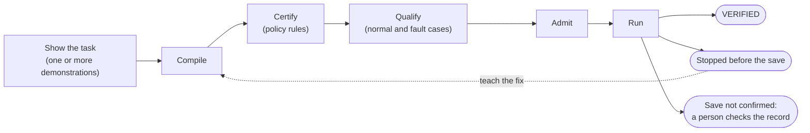

# How OpenAdapt works

OpenAdapt is a compiler and a runtime for data-entry work in applications
that have no usable API. A person or an agent shows the task once or a few
times. OpenAdapt compiles what it saw into a program. The program runs the
same steps every time, checks each one, and stops when it can't confirm the
next step is safe.

## A program, not a model in a loop

A computer-use agent decides each click by sending screenshots to a model.
OpenAdapt makes those decisions once, at compile time, from the
demonstrations. At run time it replays the compiled steps. A healthy run makes
zero model calls, so it costs nothing per step, does the same thing every
time, and sends no screens anywhere.

The compiled program is a file you can read. `openadapt flow visualize`
draws each step, how it finds its target, and which checks guard it.

## Three checks around every save

Each step that changes a record is guarded three ways:

1. **Before acting**, a right-record check confirms the screen shows the
   record the inputs name, for example the right patient.
2. **The action** itself: the click or the typing, on a target found the
   same way it was found in the demonstration.
3. **After saving**, a record check reads the saved record back through a
   different path from the screen, such as the app's API or database. A
   success banner on screen doesn't count.

If any check fails or can't tell, the run stops. When it stops before the
save, nothing was written. When the save may have gone through but couldn't
be confirmed, the run ends `RECONCILIATION_REQUIRED` and never retries on its
own; a person checks the record.

## From demonstration to production

| Stage | What it establishes |
|---|---|
| Compiled | The demonstration became a program that can be replayed. |
| Certified | The program meets a policy's rules, for example every save has a right-record check. |
| Qualified | In a test copy of the real environment, the program saved correctly on the normal case and stopped on five deliberate faults. |
| Admitted | A signed admission lets that exact program version run under the Standard or Regulated profile. |

Compiling isn't certifying, and certifying isn't qualifying. Each stage is a
separate gate, and the run report says which ones a run passed.

## When the screen changes

Each step stores several ways to find its target, strongest first: the
page or window structure where the app exposes one, then image matching, then
text found by OCR, then position relative to nearby landmarks. An optional
vision model can propose a target when all of those fail, but it's off by
default and its answer still has to pass the right-record check. See
[Surfaces](surfaces.md).

When none of them finds the target, or the right-record check fails, the run
stops and writes what it saw. Someone records the fix, `teach` adds it to the
program as a guarded branch, and the repaired program goes through review,
replay and fault campaigns, approval by a person, and a canary before it
replaces the old one. See [Handle a halt](../how-to/handle-a-halt.md).

## What a run leaves behind

Every run writes a report with each step, how its target was found, every
check and its result, and the number of model calls. A `VERIFIED` run also
writes a receipt that's safe to share. A run that OpenAdapt Cloud Execute
tracked can carry a Seal, Cloud's signature on that receipt, which anyone can
check offline. See [Files and evidence](../reference/artifacts.md).

## Where it runs

The engine runs on a computer that can open the application, inside your
network. It can run fully offline, with an optional model server on your own
network, or connected to OpenAdapt Cloud for shared workspaces and managed
browser runs. See [Deploy](../how-to/deploy.md).
