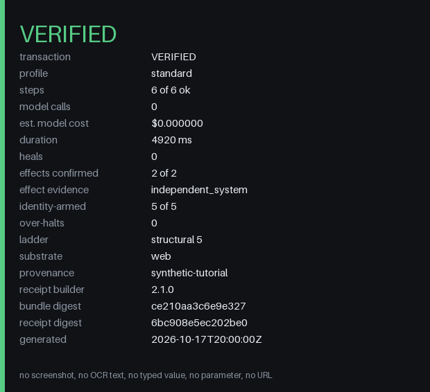

# Get started on the command line

This track installs the `openadapt` command and runs the bundled tutorial. The
tutorial uses MockMed, a synthetic clinic app with made-up patients, so it
needs no account, no app of your own, and no operating-system permissions.

The engine supports Python 3.10, 3.11, and 3.12. With
[uv](https://docs.astral.sh/uv/getting-started/installation/), you don't need
a matching Python: uv downloads Python 3.12 for the run.

## Try it without installing

```bash
uvx --python 3.12 openadapt flow tutorial
```

The tutorial starts MockMed on this computer, records the bundled
demonstration in a headless browser, compiles it, certifies the bundle, and
runs it under the Standard profile. It then reads the saved record back
through MockMed's read-only system-of-record API, which is independent of the
screen. If the browser that OpenAdapt drives isn't installed yet, the first
run downloads it.

A healthy run ends `VERIFIED` and writes a local receipt. The run enables no
model call and no Cloud call. Add `--headed` to watch the browser.

## Install the command

To keep `openadapt` on your PATH, use the installer script. It installs uv if
needed, then installs `openadapt` with Python 3.12 as an isolated tool.

=== "macOS and Linux"

    ```bash
    curl -fsSL https://openadapt.ai/install.sh | sh
    ```

=== "Windows (PowerShell)"

    ```powershell
    powershell -c "irm https://openadapt.ai/install.ps1 | iex"
    ```

=== "pip"

    On Python 3.10, 3.11, or 3.12:

    ```bash
    python -m pip install --upgrade openadapt
    ```

Then run the tutorial with the installed command:

```bash
openadapt flow tutorial
```

## What the tutorial writes

The tutorial writes everything under its output directory. The default is
`tutorials/tutorial-<UTC timestamp>` in the current directory, and `--out`
sets another one.

| Path | What it is |
|---|---|
| `<out>/recording/` | The recorded demonstration: frames, events, and metadata. |
| `<out>/bundle/` | The compiled, certified workflow bundle. |
| `<out>/run/REPORT.md` | The illustrated run report, for people. |
| `<out>/run/report.json` | The same report, for programs. |
| `<out>/run/receipt.json` | The local receipt. It's written only for a `VERIFIED` run, next to `receipt.md` and `receipt.png`. |

### What these look like

These excerpts come from one real tutorial run with `openadapt` 1.17.0. Your
run has different digests, IDs, and timings. `…` marks where a file is
trimmed.

**`receipt.png`**, the shareable picture of the receipt:

{ width="420" loading="lazy" }

**`report.json`**, with the outcome, one step, and its effect checks. The
`results` list has one entry per step; this is the last one, which saves the
encounter. Both effect checks are REST reads of MockMed's record store, not
reads of the screen.

```json
{
  "workflow_name": "local-quickstart",
  "execution_profile": "standard",
  "execution_outcome": "VERIFIED",
  "transaction_outcome": "VERIFIED",
  "production_eligible": true,
  "outcome_envelope": {
    "version": "openadapt.execution-outcome/v1",
    "outcome": "VERIFIED",
    "required_contracts": {"authorization": 1, "identity": 5, "postcondition": 9, "effect": 2},
    "passed_contracts": {"authorization": 1, "identity": 5, "postcondition": 9, "effect": 2},
    …
  },
  "effect_journal": [
    {
      "step_id": "step_005",
      "intent": "click 'Save Encounter'",
      "consequential": true,
      "attempt_state": "delivered",
      "observed_effect": "present",
      "effect_verified": true,
      "verification_performed": true,
      …
    }
  ],
  "results": [
    …
    {
      "step_id": "step_005",
      "intent": "click 'Save Encounter'",
      "ok": true,
      "risk": "irreversible",
      "resolution": {"rung": "structural", "confidence": 1.0, …},
      "identity": {"status": "verified", "mode": "structured", …},
      "postconditions_ok": true,
      "effect_verified": true,
      "effect_results": [
        "[rest] record_written: CONFIRMED — exactly 1 record(s) match the target selector",
        "[rest] field_equals: CONFIRMED — field 'note' equals the expected value"
      ],
      "effect_evidence": [
        {
          "substrate": "rest",
          "final_verdict": "confirmed",
          "observed_effect": "present",
          "endpoint_scope": "loopback",
          …
        },
        …
      ],
      …
    }
  ],
  "heal_count": 0,
  "model_calls": 0,
  "external_network_calls": "none",
  …
}
```

**`receipt.json`**, the counts behind the image. It's built from a fixed list
of fields, so it holds no screenshot, typed value, parameter, or URL.

```json
{
  "schema_version": "openadapt.run-receipt/v2",
  "outcome": "VERIFIED",
  "transaction_outcome": "VERIFIED",
  "profile": "standard",
  "steps_ok": 6,
  "steps_total": 6,
  "effects_confirmed": 2,
  "effects_required": 2,
  "effect_tier_reached": "independent_system",
  "identity_armed": 5,
  "identity_required": 5,
  "model_calls": 0,
  "external_network_calls": "none",
  "provenance": "synthetic-tutorial",
  "bundle_digest": "ce210aa3c6e9e32744e7447fd0a5d3620b78d569defbf169b4593b661b7e4866",
  "receipt_digest": "6bc908e5ec202be0669e71c86e9b0f2cebbbf88685fcaebb6f50c74e3a8b7850",
  …
}
```

Read the report, draw the compiled program, and list its coverage gaps:

```bash
less <out>/run/REPORT.md
openadapt flow visualize <out>/bundle --out graph.html
openadapt flow lint <out>/bundle
```

The tutorial exits `0` when the run is `VERIFIED`, `1` on any other outcome,
and `2` when it refuses to start. [Run outcomes](../reference/run-outcomes.md)
lists every outcome.

## Make it stop on purpose

```bash
openadapt quickstart --break-it
```

This runs the same tutorial, then reruns the same certified bundle against a
MockMed server that shows a saved banner but rejects the write. Every check on
the screen passes. The independent read of the system of record finds no
record, so the run ends `HALTED` instead of reporting success.

The rerun's transaction outcome is `RECONCILIATION_REQUIRED`, shown as "Check
the record". The engine saw a write attempted and refuted, and it doesn't claim
that nothing was written unless it can prove it. In this synthetic store, the
record count stays at zero. The halted run gets no receipt.
`openadapt flow tutorial --break-it` does the same in the tutorial's own output
directory.

`openadapt quickstart` writes to `openadapt-quickstart` in the current
directory, or `openadapt-quickstart-2` and so on when that exists. The halted
rerun's report is in `run-broken/REPORT.md` under that directory. It never
overwrites an existing directory.

## Next

- [Author a workflow](first-workflow.md) on your own web app. Start with a
  lookup that doesn't change business data.
- [Record your own app](../guides/record-your-app.md) covers recording,
  compiling, and replaying in more depth.
- [The openadapt flow CLI](../reference/cli.md) lists every command and flag.
