# Handle a halt

A run stops whenever it can't confirm the next step is safe: the screen
changed, the wrong record is open, two records match, or the record check
didn't find the save. Stopping is the designed behavior. This page covers
what happens next.

## 1. Find out why it stopped

```bash
openadapt flow explain runs/<run-dir>
```

`explain` names the step, the check that failed, and the next command to
run. The same detail is in `REPORT.md` in the run directory. A run that
stopped before a save wrote nothing.

If the outcome is `RECONCILIATION_REQUIRED`, a save may have gone through.
Have a person check the record in the application before anything else. No
command retries that save automatically.

## 2. Decide the paused item

A durable run pauses at the halt. Someone decides what happens to that item:

```bash
openadapt flow approve runs/<run-dir> --approver "jane@clinic.example"
openadapt flow resume runs/<run-dir> --require-approval
```

`approve` records who decided and which option they chose (`--resolution`).
`resume` checks the live screen, the record, and the target again before it
continues, and never repeats a confirmed save. In OpenAdapt Desktop and in
the hosted phone view, the same pause offers only the actions that fit that
halt, such as resume, skip, reject, teach, escalate, or reconcile.

## 3. Teach the program the fix

When the same halt will recur, for example a new dialog that must be
dismissed, record only the corrective steps and teach them to the program:

```bash
openadapt flow record --url https://staging.your-app.example --out fix
openadapt flow teach runs/<run-dir> --fix fix --bundle bundle --out bundle-v2
```

`teach` turns the fix into a guarded branch for that halt. It replays the
original evidence to check that the fix doesn't weaken any check, and writes
`bundle-v2` only when the fix passes. A rejected fix is quarantined and the
program keeps stopping at that point.

When the right fix depends on the situation, teach a branch from two or more
halted runs and their fixes:

```bash
openadapt flow teach-branch \
  --example runs/halt-1 fix-1 --example runs/halt-2 fix-2 \
  --normal-run runs/ok-1 --bundle bundle --out bundle-v2
```

## 4. Let a calling agent help

When an agent calls the workflow through the MCP server and the run stops,
the result carries `needs_repair` with the step and a one-time repair token.
If an administrator turned on screen access for repairs
(`openadapt agent repair access`, then `serve --repair-access FILE`), the
agent can look at the stopped screen and demonstrate the fix with
`get_repair_screen` and `teach_repair`. `--hold-on-halt` keeps the stopped
browser page open for that, 300 seconds by default.

The agent's fix becomes a candidate like any other. The agent can't review
or approve its own candidate.

## 5. Promote the repaired program

A repaired bundle never replaces the running one just because it exists.
It goes through a fixed sequence, and no step can be skipped:

```mermaid
flowchart LR
  C[Candidate] --> R[Diff reviewed by a person]
  R --> P[Replay campaign passes]
  P --> F[Fault campaign passes]
  F --> A[Approved by a person]
  A --> S[Staged by hash]
  S --> K[Canary: first runs checked]
  K --> V[Active]
  K -. regression .-> S
  V -. rollback .-> B[Prior version restored]
```



```bash
openadapt flow repair register bundle-v2 --prior bundle --source teach --evidence runs/<run-dir>
openadapt flow repair review <id> --reviewed-by "jane@clinic.example"
openadapt flow repair campaign <id> --kind replay
openadapt flow repair campaign <id> --kind fault
openadapt flow repair approve <id> --approved-by "jane@clinic.example"
openadapt flow repair stage <id>
openadapt flow repair canary <id> --max-runs 5
openadapt flow repair canary-record <id> --run-dir runs/<canary-run>
openadapt flow repair rollback
```

`register` refuses a candidate that weakens any check. The fault campaign
must refuse every adversarial case: ambiguity, wrong record, stale target,
an unexpected dialog, and a failed record check. During the canary, any wrong
success or failed check switches back to the prior bundle automatically.
Models never approve or promote a repair.
