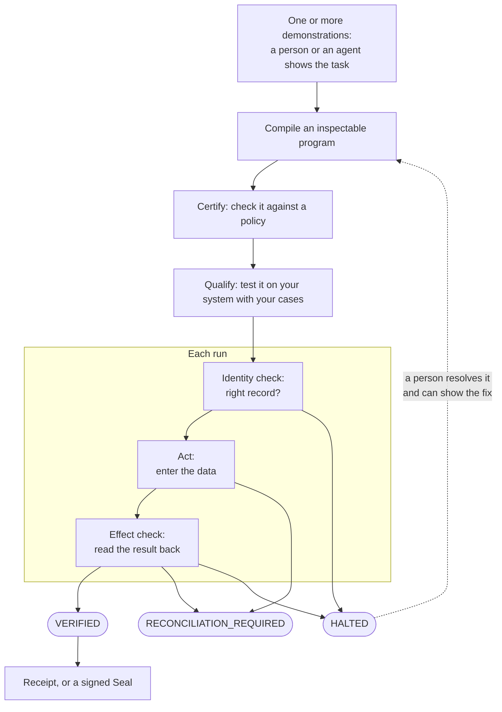

# Take the last manual step off your team

<p class="oa-lede">
OpenAdapt enters approved information into the systems you already use, such
as EMRs, payer portals, and desktop and Citrix apps, and checks that it saved.
When something doesn't match, it stops and asks a person instead of guessing.
</p>

## What it is

OpenAdapt is a demonstration compiler with a governed runtime. A person or an
agent shows the task in the real app. OpenAdapt compiles one or more
demonstrations into an inspectable program, and a person accepts it before it
does real work. A person, Desktop, or an AI agent then runs that program. A
normal run makes no AI model calls. The engine is open source under the MIT
license.



`HALTED` means a check failed, so the run stopped and asked a person.
`RECONCILIATION_REQUIRED` means a save may have gone through, so a person
checks the record before anything is retried.
[Run outcomes](reference/run-outcomes.md) lists every outcome, and the
[glossary](reference/glossary.md) defines each step. A fix that a person shows
after a halt becomes a new candidate program. It must pass qualification again
before it replaces the old one; see
[the halt-learn loop](concepts/halt-learn-loop.md#the-learn-loop).

`VERIFIED` means the declared result checks passed through a read that is
independent of the acting screen. The strongest read goes to the system of
record itself: its API, database, file export, or document. A separate
read-only session of the app is weaker, because it reads through the same
interface the run used. A "Saved" message on the acting screen doesn't count. [Effect verification](concepts/effect-verification.md)
explains why.

## Try it

The bundled tutorial runs on a synthetic app on your computer. It needs
Python 3.10 to 3.12, no account, and no app of your own.

```bash
python -m pip install --upgrade openadapt
openadapt flow tutorial
openadapt quickstart --break-it
```

The first run ends `VERIFIED` and writes a local receipt. The second shows a
saved banner while the store rejects the write, and the run halts instead of
reporting success. [Get started on the command line](get-started/cli.md) has
the uv installer and what each run writes.

## Choose your path

<div class="grid cards" markdown>

-   [__Evaluate one workflow__](evaluate/index.md)

    For a business reader: what changes for your team, four worked examples,
    and how a first project runs. No install.

-   [__Install and try it__](get-started/index.md)

    Three tracks: the command line, the Desktop app, or an agent connected
    over MCP. Each installs the same engine.

-   [__Connect an AI agent__](get-started/agent-mcp.md)

    Call a compiled workflow as one MCP tool and branch on its outcome.

-   [__Review security and procurement__](guides/security-review.md)

    For IT, security, and procurement reviewers: execution boundaries, data
    flow, encryption, release integrity, a review checklist, and the
    [procurement FAQ](commercial/procurement-faq.md).

-   [__Prepare a production workflow__](guides/qualify-a-workflow.md)

    Bind identity and effect checks, run representative and fault cases,
    certify, and admit one exact workflow version.

-   [__Look something up__](reference/index.md)

    The CLI, run outcomes, the bundle format, deployment configuration, and
    the glossary.

</div>

## When it fits

OpenAdapt fits a task when most of these are true:

- The team does it the same way many times a week.
- What to enter is already decided, by a person, a form, or an AI agent.
- The target app has no practical API for the write. It can be a web app, a
  native Windows, macOS, or Linux app, or an app reached over RDP or Citrix.
- A wrong entry costs money, time, or compliance trouble.
- There's a second way to read the saved record, such as an API, a database,
  a report, or a read-only login.

It doesn't fit when a direct API or batch interface can already make the
change, when the result can't be checked and the risk doesn't allow a
screen-only check, or when the task needs judgment that can't be reduced to
checkable rules. [Qualification evidence](get-started/what-works-today.md)
lists what has been tested on each surface and its limits, and the
[Production admission](reference/production-lifecycle.md) page defines a
qualified workflow.

## Who approves what

A person admits each compiled program version before it handles real work, and
reviews any proposed repair before it's promoted. Approval of individual items
is a setting of the run, not a fixed rule:

- `each_item`, the default under the Standard and Regulated profiles: the run
  waits before each save until a person approves it in Desktop.
- `not_gated`: no per-item pause. It must be set explicitly, and the run report
  records it. Cloud-dispatched runs use this mode.
- `problems_only` asks a person only about items that fail a check. The engine
  has it, but a customer can't turn it on yet.

Every run still stops and asks a person when an identity, result, or policy
check fails. See [What you see and control](evaluate/what-you-see.md).

## The caller contract

A calling agent, Desktop, or a script reads one result per run. The plain label
and the MCP `outcome` both come from the engine's `transaction_outcome`, which
states what is known about the business write. The coarser
`execution_outcome` (`VERIFIED`, `COMPLETED_UNVERIFIED`, `HALTED`, `FAILED`, or
`ROLLED_BACK`) doesn't say on its own whether anything was written.

| `transaction_outcome` | Label people see | MCP `outcome` | What the caller may do |
|---|---|---|---|
| `VERIFIED` | Done and checked | `done` | Mark the request complete. Don't send it again. |
| `HALTED_BEFORE_EFFECT` | Stopped before saving | `needs_review` | Don't start the same work again. A person decides. |
| `REJECTED_POLICY`, `CANCELED` | Stopped before saving | `did_not_run`, or `needs_review` while a person holds the run | Fix the cause. Resend only when `safe_to_retry` is true. |
| `FAILED_PLATFORM` | Didn't finish | `did_not_run`, or `needs_review` while a person holds the run | Fix the setup. Resend only when `safe_to_retry` is true. |
| `RECONCILIATION_REQUIRED`, `ROLLED_BACK` | Check the record | `not_sure_if_saved` | Never retry. A person checks the record. |
| `COMPLETED_UNVERIFIED` | Finished, not checked | `not_sure_if_saved` | Don't treat it as success. Add a record check. |

The calling agent may bind declared parameters, invoke a compiled program,
supply a missing declared parameter, retry a retryable transport failure with
the same request id, and escalate. It must not summarize a halt as success,
resolve an identity or effect contradiction itself, or invent clicks to work
around a stop. The machine contract is in [agents.txt](agents.txt), and every
outcome and halt reason is in [Run outcomes](reference/run-outcomes.md).

## Where it runs

| Surface | Execution options | Evidence available |
|---|---|---|
| Browser | Local, customer-controlled, or managed for approved workflows | DOM, accessibility, visual, geometry, and interaction evidence |
| Windows, macOS, Linux | Local or customer-controlled | Native accessibility data plus retained visual evidence |
| RDP, Citrix, VDI | Local or customer-controlled | Window-scoped pixels, keyboard, mouse, OCR, and visual anchors |

Sensitive runtime observations stay inside the declared execution boundary.
Only an approved, sanitized derivative can cross it. See
[the deployment matrix](concepts/deployment-matrix.md) and
[Security and data handling](guides/security-and-data-handling.md).

[Watch a recorded run on OpenEMR with synthetic data](https://app.openadapt.ai/demo){ .md-button }
[Check the current Production status](reference/production-lifecycle.md){ .md-button }
