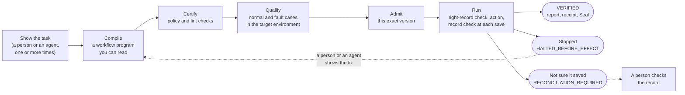

# OpenAdapt

OpenAdapt gives an agent, a person, or a script a reliable way to finish a
task in an application that has no usable API. A person or an agent shows the
task in the real application. OpenAdapt compiles one or more of these
demonstrations into a workflow program you can read. Before the program does
real work, it is checked against a policy, tested against normal and faulty
cases in the target environment, and admitted for that exact version.

When the program runs, each step that saves something does three things:

1. It checks that the right record is on screen.
2. It performs the action.
3. It reads the result back from the system of record, such as the
   application's API, a read-only database query, or a file export, and
   compares it with what it entered.

If any check fails, the run stops instead of guessing. A healthy run makes no
AI model calls. The engine is open source under the MIT license.



[How OpenAdapt works](explanation/how-it-works.md) walks through each stage.
Terms are defined once, in the [glossary](reference/glossary.md).

## Try it in one command

```bash
uvx --python 3.12 openadapt quickstart --break-it
```

This runs a synthetic clinic task twice on your computer. The first run saves
a note and confirms it through the app's read-only API. In the second run the
app shows "saved" but the server drops the write, and OpenAdapt stops instead
of reporting success. [The quickstart tutorial](tutorials/quickstart.md)
explains the output line by line.

## Choose where to start

<div class="grid cards" markdown>

-   __Developers__

    Install the engine, automate a workflow, connect an agent, and look up
    commands and outcomes.

    [Quickstart](tutorials/quickstart.md) ·
    [Your first workflow](tutorials/first-workflow.md) ·
    [Connect an agent](how-to/connect-an-agent.md) ·
    [Command line](reference/cli.md)

-   __Security & procurement__

    Where data lives, deployment boundaries, what has been tested, and how a
    paid engagement works.

    [Security overview](security/index.md) ·
    [Data handling and PHI](security/data-handling.md) ·
    [Release status](security/release-integrity.md) ·
    [Procurement FAQ](security/procurement-faq.md)

</div>

## When it fits

OpenAdapt fits a task when most of these are true:

- The team does it the same way many times a week.
- What to enter is already decided, by a person, a form, or an AI agent.
- The application has no practical API for the write. It can be a web app, a
  Windows, macOS, or Linux app, or an app reached over RDP or Citrix.
- A wrong entry is costly.
- There is a second way to read the saved record, such as an API, a database,
  a report, or a read-only sign-in.

If the application already has an API for the task, call the API. The
[limits page](explanation/limits.md) lists what OpenAdapt doesn't do.

## What the packages are

On Python 3.10 to 3.12, `pip install openadapt` installs the `openadapt`
command, the engine (`openadapt-flow`), and the agent bridge
(`openadapt-agent`). The
[packages map](reference/packages.md) lists every package and repository and
which ones you need.
