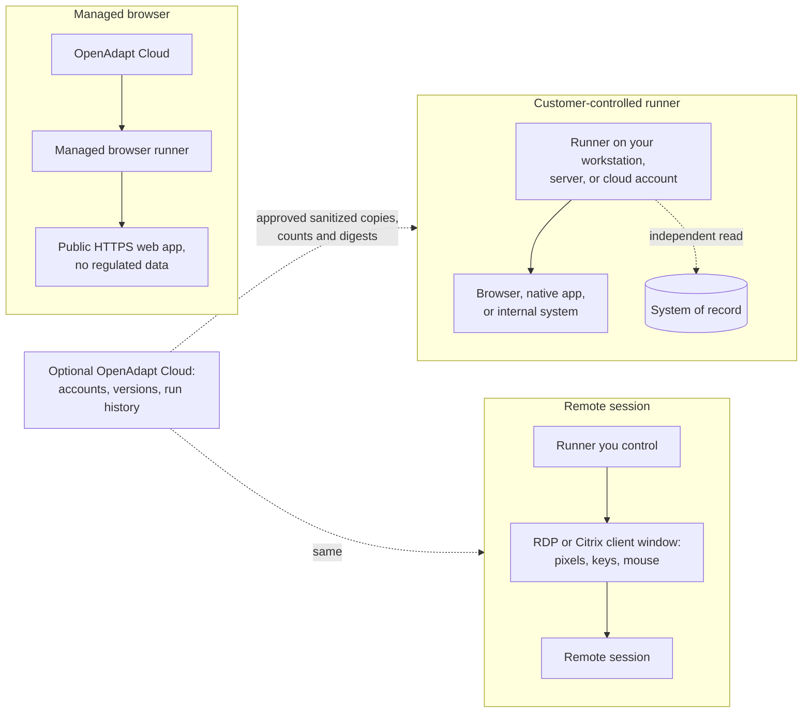

# Deployment boundaries

Every deployment runs the same engine with the same checks and writes the
same reports. Deployments differ in where the runner is and what may cross
to OpenAdapt.

## Managed browser

OpenAdapt runs the control plane and a browser runner. This is for public
HTTPS web apps and data that isn't regulated. Patient data and other
regulated workloads don't belong here and aren't admitted. Desktop, RDP, and
Citrix jobs never go to this runner.

## Customer-controlled runner

The runner is on infrastructure you control: a workstation, a server, a
virtual machine, or your own cloud account. This is the standard choice for
regulated work. Screens, typed values, and record-check results stay inside.
If you connect it to OpenAdapt Cloud, only approved sanitized copies, halt
reports without patient data, and digests cross. A fully offline deployment
sends nothing.

## Remote session

The runner is yours, but the application is in an RDP, Citrix, or other
virtual desktop session. OpenAdapt drives the client window from pixels,
keyboard, and mouse, and installs nothing in the remote session. The rendered
frames are handled under the runner's local data policy. `VERIFIED` still needs a record check that
doesn't go through the session being driven, such as the application's API
or database. Where only the client window's pixels are available, the run
can't end `VERIFIED`, and high-risk workflows may not qualify.

## In every deployment

- Secrets are referenced by name and supplied at run time. They never enter
  artifacts.
- Raw recordings and bundles don't cross a boundary. Only approved sanitized
  copies do.
- The acceptance target is zero runs that report success while the record
  disagrees.
